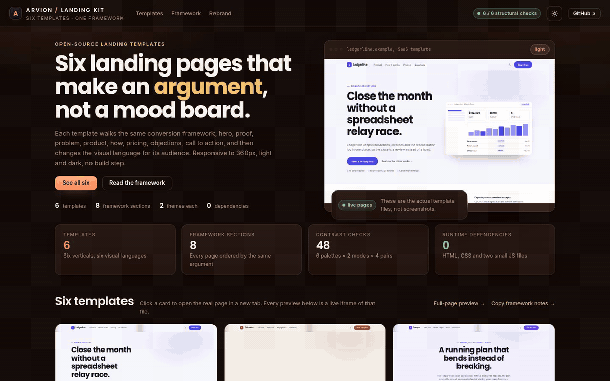
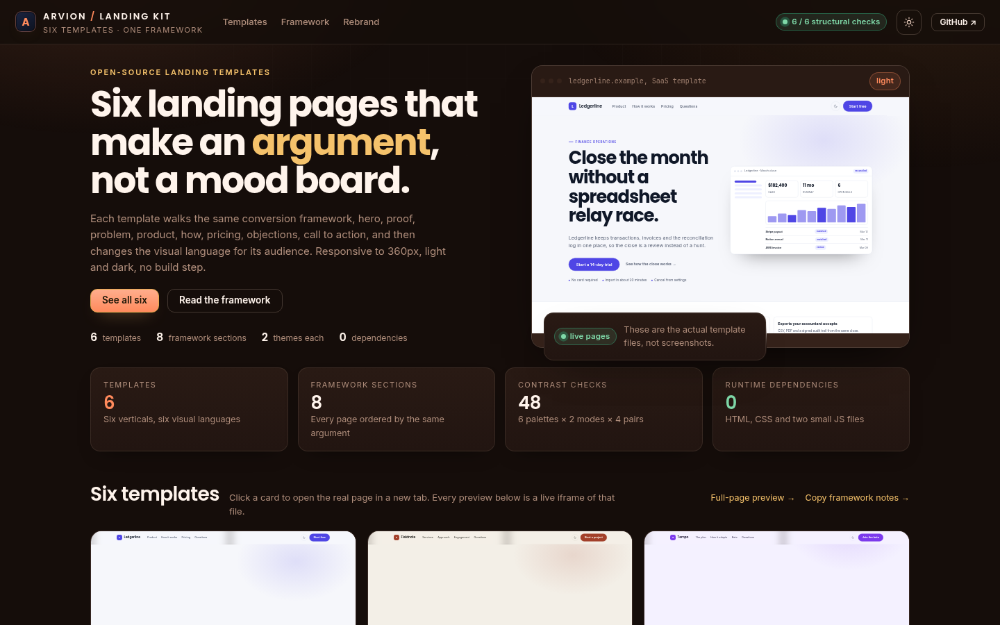
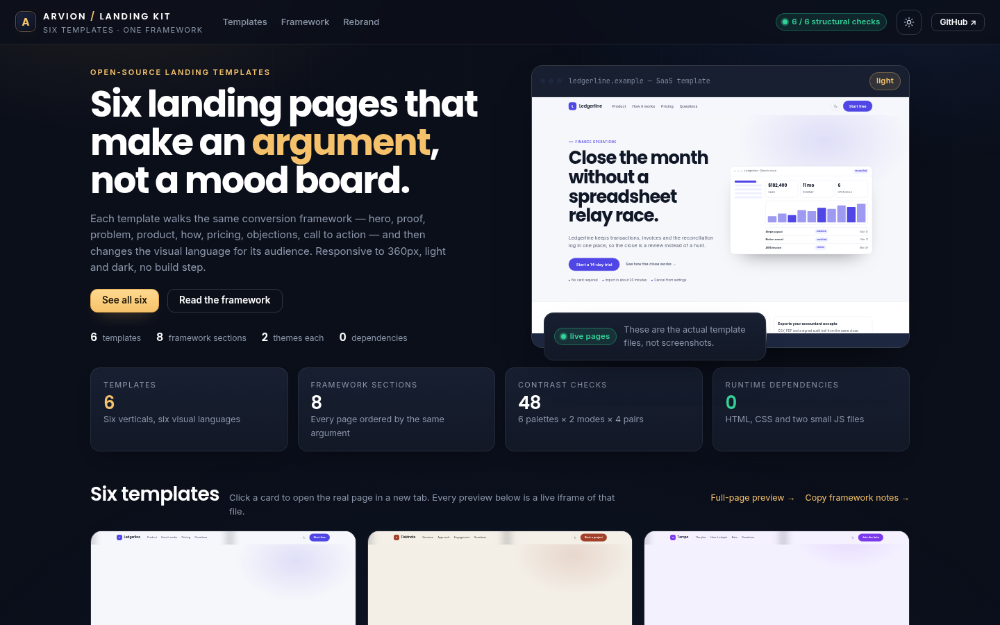

<div align="center">

</div>

<sub>Recorded from the live demo — <a href="docs/demo.mp4">MP4</a> · <a href="docs/screenshot.png">static frame</a></sub>

# Landing Kit

Six complete landing page templates, each built on the same documented
conversion framework and then redesigned for its audience. The gallery is a live
switcher: the previews are iframes of the actual template files, not screenshots.
Every page has a light and a dark theme, works down to 360px, and ships as plain
HTML and CSS with no build step.

[**Open the live demo**](https://arvion-technology.github.io/labs/demos/landing-kit/) · [MIT](LICENSE)

---

Most template packs give you a look and leave the argument to you. These give you
the argument first. Each page answers the same questions in the same order — is
this for me, is it real, what does it cost, why might I not — and only then
changes the visual language. The copy framework is written down in
[docs/copy-framework.md](docs/copy-framework.md), including the sections each
template deliberately leaves out and why.

The six products in the templates are fictional on purpose. There are no invented
customer counts, no logo walls and no paid endorsements anywhere in the pages.

## What it does

- **A switcher gallery** — six live iframes scaled to thumbnails, with the
  palette, section count and measured minimum contrast for each template.
- **SaaS (Ledgerline)** — light finance interface, dashboard hero, visible
  pricing and an exception-queue product section.
- **Agency (Fieldnote)** — warm editorial typography, no logo wall, and an
  engagement model in place of case studies the studio may not publish.
- **Mobile app (Tempo)** — dark, phone-first hero, an adaptive running plan, and
  an honest beta CTA because there is no App Store listing to link.
- **AI product (Vela)** — a cited-answer prompt mock in the hero and a citation
  policy as the proof section.
- **Marketplace (Swap)** — neighbourhood listings with escrow mechanics, and a
  separate seller block rather than pretending both audiences are the same.
- **Developer tool (Relay)** — terminal aesthetic, a replay command in the hero,
  retention and redaction as the proof.
- **A recorded conversion framework** — eight sections with their job, required
  elements and most common mistake, plus per-template adaptation notes.
- **Twelve palettes with tested contrast** — eight semantic colour tokens per
  template, light and dark, with four WCAG pairs checked in code.

## Screenshots

| The switcher gallery | The agency template |
| --- | --- |
|  |  |

## Architecture

```text
projects/27-landing-kit
├── src/
│   ├── framework.js   eight section definitions, six template configs,
│   │                  structural validation and coverage counts
│   ├── palettes.js    twelve palettes (six templates × two modes)
│   ├── contrast.js    WCAG luminance and ratio, kept local to this repo
│   └── theme.js       gallery theme helpers
├── demo/
│   ├── index.html     switcher gallery, framework table, rebrand guide
│   ├── app.js         renders cards, scales iframes, full-page preview mode
│   ├── index.css      gallery chrome
│   ├── landing.css    shared stylesheet + all twelve palette blocks
│   ├── landing.js     theme persistence, mobile nav, reveal on scroll
│   └── templates/     six complete pages, one file each
├── test/              framework, palette and template-file suites (30 cases)
├── docs/
│   ├── copy-framework.md
│   └── screenshot*.png
└── scripts/           zero-dependency server, screenshot, static checks
```

The gallery imports the same `src/` modules the tests use, so the section counts,
palette scores and validation results on the page are computed rather than typed.

## Quickstart

```bash
git clone https://github.com/arvion-technology/landing-kit.git
cd landing-kit
npm test                     # 30 tests, no dependencies, Node 20+
npm run demo                 # http://localhost:4173/demo/
```

To work on one template only, open it directly — each file is standalone:

```bash
node scripts/serve.mjs . 4173
# then: http://localhost:4173/demo/templates/saas.html
```

Screenshots use headless Chromium:

```bash
npm run shot      # the gallery
npm run shot:2    # the agency template in full-page preview mode
```

## How it works

**The order is the framework, not a layout choice.** `src/framework.js` defines
eight sections in this order: hero, proof, problem, product, how it works,
pricing, objections, call to action. Each one carries its job, the elements it
must include and the mistake that usually ruins it. A template config lists which
sections it uses; `validateTemplate()` rejects a page that starts anywhere but the
hero, ends anywhere but the final CTA, or reaches fewer than seven sections. The
tests run that validation over all six configurations, then read the HTML files
and check every declared section actually has a `data-section` marker in the file.

**Omissions are data.** The agency template has no pricing section because a
fixed-scope studio sells an engagement, not a plan; the marketplace template has
no problem section because both audiences already know it. Those choices live in
the config as missing ids, and the gallery prints them in the card footer. A
section can be dropped, but it cannot disappear silently.

**Twelve palettes, one contract.** Each template maps eight semantic tokens:
`bg`, `surface`, `text`, `muted`, `accent`, `onAccent`, `line`, `tint`. The
stylesheet declares them per template for light mode and again under
`html[data-theme="dark"]`. `src/palettes.js` holds the same values, and a test
reads `demo/landing.css` to assert every hex from the source of truth appears
verbatim — so a palette edit cannot land on one side only. The other test suite
runs four contrast pairs on all twelve palettes: body text on the page,
secondary text on the page, the label on the action colour, and the action colour
as text. All forty-eight combinations pass AA.

**The gallery previews are real pages.** The thumbnail iframes load the template
files at 1440×900 and are scaled by dividing the frame width by 1440 in
JavaScript, then re-fitted on resize. That is why the gallery stays correct at
every breakpoint instead of relying on a hard-coded CSS scale. The second
screenshot uses a full-page preview route (`#/view/agency`) that renders one
template edge to edge in an iframe, so the image is still the real page.

**No fake proof is a constraint, not a slogan.** The copy rules in
`docs/copy-framework.md` say what to do instead of a logo wall: show a mechanism
the reader can verify. That is why Ledgerline's proof is the append-only
reconciliation log, Vela's is the inline citation, Swap's is the escrow flow and
Fieldnote's is the engagement model. A test strips HTML comments from each
template and fails on endorsement language, award claims or an invented customer
count.

## Tests

```bash
npm test
```

Thirty cases across three suites:

| Suite | What it checks |
| --- | --- |
| `framework.test.js` | eight sections, six templates, clean validation, hero-first/CTA-last order, proof/product/objections coverage, omissions, rejection of broken configs |
| `palettes.test.js` | both modes for all six palettes, hex validity, all forty-eight contrast pairs, the `--lk-*` contract, unknown-id handling |
| `templates.test.js` | all six HTML files exist and are complete pages, section markers match their config, no remote assets, no placeholders or fabricated proof, every palette value present in the stylesheet, responsive and reduced-motion rules |

The demo also has a static check for asset wiring and placeholder text:

```bash
node scripts/serve-check.mjs
```

## Limitations

- The six products are fictional sample businesses. Only the pages and the
  framework are real; the names, prices and product claims are demonstration copy
  to be replaced on rebrand.
- There are no photographs. Every visual is CSS or inline SVG, so the templates
  stay dependency-free. A real deployment would add its own art direction.
- Forms are absent by design. The CTAs are anchor links or `mailto:` links; there
  is no backend and no analytics.
- "Lighthouse-friendly" would be a claim about a specific deployment. The pages
  load locally, use no remote assets and no framework, but this repository does
  not include a Lighthouse score to quote.
- The dark theme is a second palette, not an automatic inversion. Each template
  was re-tuned for dark surfaces and tested for contrast in both modes.

## Project layout

```text
27-landing-kit/
├── src/
│   ├── framework.js    sections, template configs, validation
│   ├── palettes.js     palettes + contrast audit
│   ├── contrast.js     WCAG maths
│   └── theme.js        gallery theme resolution
├── demo/
│   ├── index.html      gallery, framework table, rebrand guide
│   ├── app.js          gallery rendering and iframe scaling
│   ├── index.css       gallery styles
│   ├── landing.css     shared template stylesheet and palettes
│   ├── landing.js      theme, nav, reveals
│   └── templates/      saas, agency, app, ai, marketplace, devtool
├── test/               three node:test suites
├── docs/               copy framework and screenshots
└── scripts/            serve, shot, static checks
```

## Credits

Built by [Arvion Technologies](https://arviontech.net) in Kathmandu. The
framework came out of our own pitch pages: the hero and the objections were the
two sections we kept rewriting, so they are the two this repository documents
most carefully. MIT licensed.
